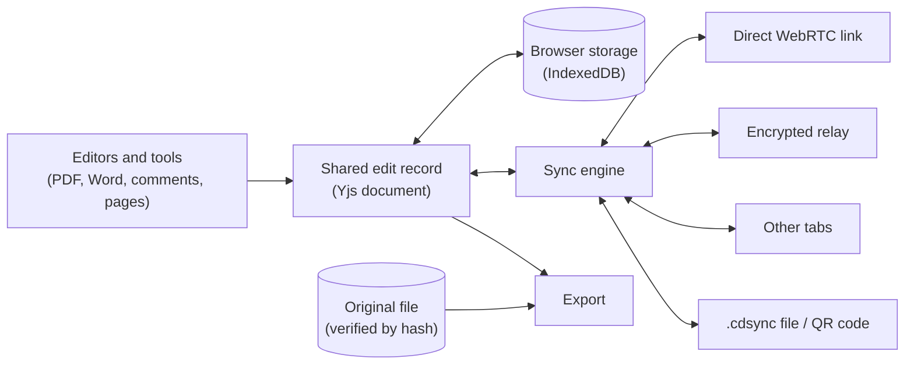

# Peer Docs

**Edit PDFs and Word documents together, with no server and no internet required.**

Peer Docs is a collaborative document editor that runs entirely in the browser. People can edit the same document at the same time, or separately while offline for days or weeks, and their changes always merge into the same result. Edits travel directly between devices, never through a server that stores or reads them.

> Built for UN Sustainable Development Goal 9.c: universal and affordable access to information technology.

---

## Why it exists

Most collaborative editors assume a reliable connection to a central server. That assumption fails for many people: rural schools, field teams, clinics, offices with restricted networks, or anyone who simply doesn't want their documents on someone else's servers.

Peer Docs is designed around three promises:

1. **Offline is normal.** You can open, edit and save without a connection. The app itself installs and loads offline.
2. **No central server.** Devices talk to each other directly. Public infrastructure is used only to help devices find each other, and it only ever sees encrypted data.
3. **Edits never conflict.** Two people can change the same document in any order, online or off, and both copies end up identical, with nothing lost.

---

## What you can do

**Edit and review PDFs**
- Change the PDF's existing text in place, or add new text, whiteout and signatures.
- Highlight, draw, add sticky notes and discuss each one in a comment thread.
- Reorder, rotate, delete and extract pages.
- Redact permanently: redacted pages are flattened to an image, so the hidden text is gone, not just covered.
- Merge, split, compress, watermark and password-protect PDFs.

**Edit Word documents**
- Open `.docx` and legacy `.doc` files in a page-view editor with styles, lists, tables and images.
- Export back to `.docx`. Anything the editor doesn't understand is kept exactly as it was.

**Work together**
- See who is in the document, what tool they are using and where their cursor is.
- Every item shows who added it and when.
- Undo and redo only affect your own changes.
- Invite people with a personal link, and remove them at any time.

**Sync without a network**
- Export your changes to a small `.cdsync` file and pass it on by USB drive or email.
- Or sync two devices with no network at all: one shows an animated QR code, the other scans it with its camera.

---

## How it works

### The core idea: the original file plus a log of edits

Peer Docs never edits the original file directly. Instead, each document has two parts:

- **The original file**, stored unchanged on each device. Its SHA-256 hash becomes the document's ID, so every copy can be verified.
- **A shared record of edits**, kept as a [CRDT](https://crdt.tech/) using [Yjs](https://github.com/yjs/yjs). A CRDT is a data structure designed so that edits made in any order on any device always merge to the same result, without a server deciding who wins.

When you export, the edits are applied to the original file to produce the final PDF or Word document.



### Syncing between devices

When two devices connect, they first compare what each has already seen and send each other only what is missing. This is how weeks of offline work catch up in seconds. After that, every new edit is sent live.

Edits can travel several ways, and the app uses whichever work:

| Route | When it's used |
| :--- | :--- |
| **Direct WebRTC link** | The normal path. Devices find each other through public WebTorrent trackers, then connect directly. |
| **Encrypted MQTT relay** | When a direct link can't be made (strict Wi-Fi, carrier NAT, firewalls). Messages pass through public MQTT brokers, encrypted end to end so the brokers see only ciphertext. |
| **BroadcastChannel** | Between tabs of the same browser. |
| **`.cdsync` file** | When devices are never online at the same time. |
| **Animated QR code** | When there is no network at all. Carries edits only, so both devices need the original file already. |

The original file is sent once, in small chunks that are checked against the document's hash before use.

### Who can join

Having a copy of the file is not enough to join its room.

- Whoever opens a document first owns its room. Each browser has its own cryptographic identity, stored locally and never exported.
- The owner keeps a signed member list and a secret room key. Every connection route is derived from that key, so outsiders can't find or read the room.
- **Inviting** creates a one-time link. When the invitee opens it, the owner's browser admits them automatically.
- **Removing** someone replaces the room key and shares the new one with everyone else, which locks the removed person out.

### Offline by design

- Edits are saved to browser storage (IndexedDB) as you work, so they survive closed tabs, restarts and long offline periods.
- The app is an installable PWA. A service worker caches the whole app, so it opens with no network. Updates download in the background and apply when you choose to reload.

---

## Project structure

```
src/
├── App.tsx               App shell: opening documents, routing between tools
├── components/           Editors and tools (EditTool, WordEditor, OrganizeTool, RedactTool, ...)
├── hooks/                React bindings for sync, access and layout
├── lib/
│   ├── crdt/             Shared edit record, sync engine, transports, access control, file and QR sync
│   ├── pdf/              Reading and rewriting PDF text in place
│   ├── word/             DOCX/DOC import, editing schema and export
│   ├── formats.ts        File type detection
│   └── presence.ts       Who's here, cursors and selections
├── utils/                PDF processing (export, redaction, compression, merge)
├── sw.js                 Service worker template
└── test/                 Vitest suite
```

---

## Getting started

**Requirements:** Node.js 20 or later, and a modern browser (Chrome, Edge, Firefox or Safari).

```bash
git clone https://github.com/nodesagar/peerdoc.git
cd peerdoc
npm install
npm run dev
```

The app runs at `http://localhost:3000`.

| Command | What it does |
| :--- | :--- |
| `npm run dev` | Start the development server |
| `npm run build` | Type-check and build for production |
| `npm run preview` | Serve the production build locally |
| `npm test` | Run the test suite |
| `npm run lint` | Type-check without building |

The tests cover the parts where bugs would be most costly: offline convergence between peers, the sync handshake, invite and removal, encrypted relay, file and QR sync, and PDF and Word round-trips.

### Try collaboration locally

1. Open `http://localhost:3000` and click **Try a sample PDF**.
2. Click the share button in the top bar, enter a name and click **Invite**. A personal link is copied.
3. Open that link in a different browser profile or a private window, so it has its own identity. It joins automatically.
4. Edit in both windows and watch the changes appear live.
5. To test offline merging, disconnect one window, edit both, then reconnect. Both copies converge.

### Sync two devices by QR code

Both devices must already have the same original file open.

1. On both devices, click **Sync via QR** in the top bar.
2. Leave device A on **Send**. Switch device B to **Receive** and point its camera at A's screen until it shows **Merged ✓**.
3. Click **Swap roles** on both devices and repeat, so A also receives B's edits.

The QR code cycles through a sequence of frames, and the receiver collects them in any order. Scanning uses the browser's built-in barcode detector where available and falls back to a JavaScript decoder elsewhere. If there are too many edits to fit, the app suggests a `.cdsync` file instead. Camera access needs a secure context, so use `localhost` or HTTPS.

---

## Known limitations

- **First join needs the owner online.** After that, any member can bring others up to date.
- **Removal is not retroactive.** A removed person keeps whatever they had already received.
- **The owner's browser is the source of membership.** If its storage is cleared, the member list can no longer change.
- **QR sync suits small batches of edits.** Larger changes should use a `.cdsync` file instead.

---

## Built with

React 19, TypeScript, Vite and Tailwind CSS · Yjs and y-indexeddb for the shared edit record · Trystero (WebRTC) and MQTT for transport · pdf-lib and PDF.js for PDFs · ProseMirror for Word editing.
